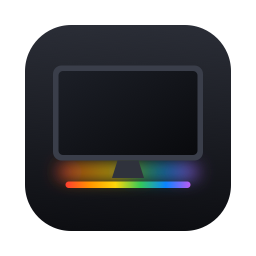
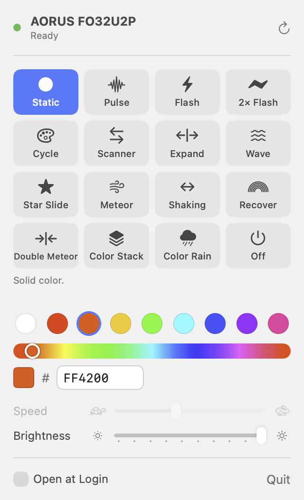

<p align="center">
  
</p>

<h1 align="center">Glowbar</h1>

<p align="center">
  <b>Control the RGB lighting on GIGABYTE AORUS monitors from macOS.</b><br>
  A native menu bar app for the monitor's LED light bar: a Mac alternative to the lighting page of GIGABYTE Control Center, which only runs on Windows.
</p>

<p align="center">
  <picture>
    <source media="(prefers-color-scheme: dark)" srcset="docs/images/panel-dark.png">
    
  </picture>
</p>

GIGABYTE doesn't make a Mac version of GIGABYTE Control Center (GCC), RGB Fusion or OSD
Sidekick, so on a Mac there's no way to change the LED lighting on an AORUS FO32U2P or a
similar AORUS FO-series OLED monitor. Glowbar talks to the monitor's lighting controller
directly over USB.

## Features

- **All 16 lighting effects built into the monitor**: Static, Pulse, Flash, Double Flash,
  Color Cycle, Scanner, Expand, Wave, Star Slide, Meteor, Shaking, Recover, Double Meteor,
  Color Stack, Color Rain and Off
- **Color, speed and brightness** controls that turn on only for effects that use them
- **Lives in the menu bar**: no Dock icon or window, optional Open at Login
- **Changes apply instantly** and your last settings are remembered
- **Command-line tool** (`glowbar`) for scripts, Shortcuts and automation
- Native Swift and SwiftUI, universal (Apple silicon and Intel), about 1 MB, no drivers or
  kernel extensions, no network access

## Supported monitors

| Monitor | Status |
| --- | --- |
| AORUS FO32U2P | ✅ Tested: all 16 effects work |
| Other AORUS FO-series monitors | Probably. Glowbar checks the monitor's firmware and only sends commands if it uses the FO-series command set |
| AORUS monitors with older lighting firmware | ❌ Not yet. They use a different command set; Glowbar detects this and sends nothing |

If you have another AORUS monitor, run `glowbar info` (it only reads from the monitor) and
[open a compatibility report](../../issues/new?template=monitor-report.yml).

## Requirements

- macOS 14 Sonoma or later
- **The monitor's USB upstream cable (USB-C or USB-B) connected to the Mac.** The lighting
  controller is a USB device inside the monitor, so a video cable alone isn't enough. If you
  use the monitor's built-in KVM, the active USB upstream port has to be the one going to the Mac.

## Install

### Download

1. Download `Glowbar-<version>.zip` from [Releases](../../releases) and unzip it.
2. Move **Glowbar.app** to Applications.
3. Glowbar isn't notarized, so macOS blocks it the first time. Open it once, then go to
   **System Settings → Privacy & Security** and click **Open Anyway**. Or run:
   ```sh
   xattr -dr com.apple.quarantine /Applications/Glowbar.app
   ```

### Build from source

Requires Xcode 16 or later.

```sh
git clone https://github.com/Kombuchelada/glowbar.git
cd glowbar
./scripts/build-app.sh --install   # builds build/Glowbar.app and copies it to ~/Applications
```

## Usage

Click the light-strip icon in the menu bar. Pick an effect, then adjust color, speed and
brightness; the monitor updates as you go. **↻** sends the current settings again (useful
after the monitor was power-cycled or switched KVM inputs).

### Command line

The app bundle includes a small CLI:

```sh
cli=/Applications/Glowbar.app/Contents/Resources/glowbar
$cli list                                   # find the lighting controller (no USB traffic)
$cli info                                   # firmware version and FO-series check (read-only)
$cli effects                                # list effect names
$cli set staticColor --color FF4200 --brightness 10
$cli set rainbowWave --speed 4
$cli set off
```

Speed is 1–6 and brightness is 1–10.

## How it works

The monitor's light bar is driven by an ITE USB HID controller (VID `0x048D`, PID `0x8295`)
that takes 64-byte HID feature reports. Each change is an effect report followed by an
"apply" report, which Glowbar sends with IOKit. [docs/PROTOCOL.md](docs/PROTOCOL.md)
describes the commands and every effect's parameters.

The protocol encoder is a small, dependency-free Swift library (`GlowbarKit`) with tests
that pin every report's bytes.

## FAQ

**Does GIGABYTE Control Center work on macOS?**
No. GCC, RGB Fusion and OSD Sidekick are Windows-only. Glowbar covers monitor lighting on Mac.

**Can it change brightness, input, or other OSD settings?**
No, only the LED lighting. Picture settings go through a different interface (DDC/CI).

**Does it need admin rights, a driver or Input Monitoring permission?**
No. macOS lets apps open vendor-specific USB HID devices like this one without extra permissions.

**Is this safe for my monitor?**
It sends only standard lighting commands, and it refuses to send anything if the firmware
isn't the FO-series type it expects. Still, this is an unofficial tool, so use it at your own risk.

**Why do some effects ignore my color?**
Scanner, Expand, Wave, Color Cycle, Recover, Color Stack and Color Rain use colors built into
the monitor's firmware.

## Development

```sh
swift build
swift test
```

| Path | What it is |
| --- | --- |
| `Sources/GlowbarKit` | Protocol encoder (`LightingProtocol.swift`) and IOKit HID transport (`MonitorLighting.swift`) |
| `Sources/GlowbarApp` | SwiftUI menu bar app |
| `Sources/glowbar` | CLI |
| `Tests/GlowbarKitTests` | Byte-level tests for every report |

Contributions are welcome, especially compatibility reports and support for more AORUS monitors.

## Disclaimer

Glowbar is an independent project. It isn't affiliated with, endorsed by or supported by
GIGABYTE Technology Co., Ltd. GIGABYTE, AORUS and GIGABYTE Control Center are trademarks of
their owners and are used here only to describe compatibility.

## License

[MIT](LICENSE)
